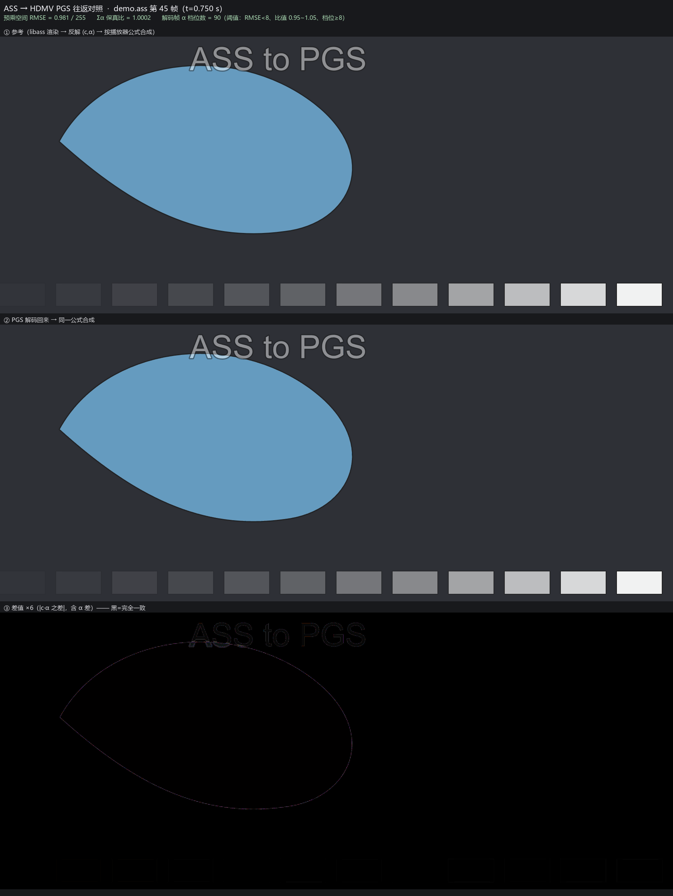
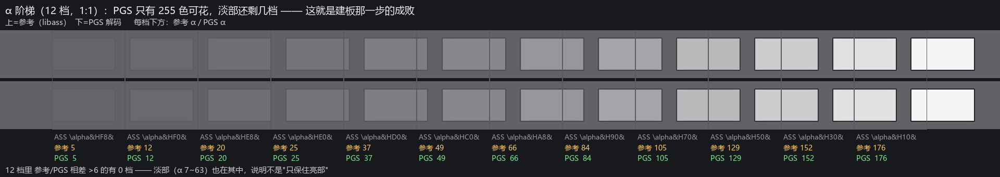

# feather-pgs · ASS → HDMV PGS

**把 ASS 字幕直接编成蓝光规格的 PGS（`.sup`）位图字幕轨**，做到 4K60 全片可用
（实测 16107 帧 / 3840×1638 / 13.2 帧每秒）。



---

## 为什么需要它：ffmpeg 从来没有 PGS 编码器

这不是"没配好"，是**能力缺失**，实测三条：

```console
$ ffmpeg -h encoder=hdmv_pgs_subtitle
Codec 'hdmv_pgs_subtitle' is known to FFmpeg, but no encoders for it are available.

$ ffmpeg -i in.ass -c:s hdmv_pgs_subtitle out.sup
Unknown encoder 'hdmv_pgs_subtitle'      # 或 Encoder (codec hdmv_pgs_subtitle) not found
```

- `ffmpeg -encoders` 全表里**没有** PGS 编码器（本机 5 个构建都验过，含 SubtitleEdit 自带的）。
  有 `sup` 封装器、有 `pgssub` 解码器，**就是没有编码器**。
- 退一步换同类的位图字幕编码器也不行：`dvdsub / dvbsub / xsub` 只支持 bitmap→bitmap
  （`Subtitle encoding currently only possible from text to text or bitmap to bitmap`），
  而 `sup` 封装器只接受 `hdmv_pgs_subtitle`。
- ffmpeg 里也**没有**"视频帧 → AVSubtitle"的通路（`-filters` 里没有任何字幕类滤镜，无 `->S` / `S->`）。

所以位流只能自己写。ffmpeg 在本工程里只干两件事：**渲染**（libass 把 ASS 画成帧）和
**独立验收**（它能把 PGS 解回 BGRA 帧，用来证明位流合规）。

## 流水线（4 步）

| 步 | 做什么 | 关键点 |
|---|---|---|
| ① **两趟黑白渲染** | 同一条字幕在黑底/白底各渲一遍 | 反解出播放器真正合成用的 `(c, α)`；**不能用 `alpha=1` 的 alpha 通道**（实测只有真实 α 的 63%） |
| ② **按内容建板** | 抽样 → 预乘空间 median cut → 255 色 | PGS 只有 256 个槽（索引 0 固定透明）；淡部 α≈2~60 全靠这步 |
| ③ **逐帧量化 + RLE** | 预乘空间最近邻；对象按内容 bbox 裁剪 | RLE 每行必须写满对象宽度，否则解码器报 `Insufficient RLE data` |
| ④ **写 display set** | `PCS/WDS/PDS/ODS/END`，90 kHz PTS | `comp_state` 用 `0x80`（首个）/`0x00`（其余）；用 `0x40` 会拖影 |

原理与取舍的完整推导见 **[docs/原理.md](docs/原理.md)**；所有踩过的坑见 **[docs/坑.md](docs/坑.md)**。

## 快速开始

```bash
# 依赖：python3 + numpy；以及一个带 libass 的 ffmpeg（PATH 里没有就设 FFMPEG=<ffmpeg 可执行文件>）
pip install -r requirements.txt

# ① 建调色板（会按 ASS 末条事件自动定长；也可 --frames/--duration 显式给）
python gen_pgs.py palette --ass examples/demo.ass --size 3840x1638 --crop 0,262,3840,1638 \
                          --step 0.25 --pal pal.npy

# ② 编码
python gen_pgs.py encode  --ass examples/demo.ass --size 3840x1638 --crop 0,262,3840,1638 \
                          --pal pal.npy --out out.sup

# ③ 自己验收（不需要任何源片，PASS 时退出码 0，可直接当 CI）
python 验收PGS.py --sup out.sup --ass examples/demo.ass --size 3840x1638 --crop 0,262,3840,1638 \
                  --frames 300 --ffmpeg-check

# ④ 封装进 mkv（⚠️ 必须关掉容器内压缩，见"交付"一节）
mkvmerge -o out.mkv --compression 0:none video.mkv out.sup
```

常用参数：`--size` 画布（= ASS PlayRes）、`--crop x,y,w,h` 只渲染内容窗口（**主要提速手段**）、
`--fps`、`--t0/--frames/--duration`、`--abs-pts`（绝对时间轴）、`--fonts-dir`（锁死字体）、
`--al-min`、`--margin`。

## 实测

### 示例（仓库自带 `examples/demo.ass`：矢量图形 + 移动文字 + 12 档 α 阶梯）

| 场景 | 建板 | 编码 | `.sup` | 往返 RMSE | Σα 保真比 | α 档位 |
|---|---|---|---|---|---|---|
| 1920×1080 全画布 · 120 帧 | 12 帧抽样 / 12,352 色 → 255 色 | 18 s（≈6.7 帧/秒） | **5.0 MB** | **0.712** / 255 | **1.0001** | 108 |
| 1920×1080 窗口 1400×800 · 120 帧 | 10 帧抽样 → 255 色（α<16 有 13 色） | 12 s（≈10 帧/秒） | 4.3 MB | 3.799 / 255 | 1.0152 | **143** |
| 3840×2160 窗口 3840×1638 · 300 帧 | 24 帧抽样 / 17,221 色 → 255 色 | 137 s（**2.2 帧/秒**） | 10.6 MB | 3.817 / 255 | 1.0110 | 134 |

`α 档位` = 解码帧里出现的不同 α 值个数。示例里那条 12 档阶梯实测**逐档一致**
（参考 6/13/22/31/47/63/88/111/144/175/208/239 ↔ PGS 同值），淡部 α 7~63 一档没塌：



### 真实全片（4K60 稀疏粒子字幕，3840×1638）

| 项 | 实测 |
|---|---|
| 帧数 / 时长 | 16107 帧 / 268 s |
| 建板 | 396 s（抽 412 帧 / 33.0 万色 → 255 色） |
| 烧 PGS | 1219 s @ **13.2 帧/秒** |
| `.sup` 体积 | 1061.4 MB |
| 封装（mkvmerge） | 43 s |
| 整趟 | **≈28 分钟** |

> **吞吐由"覆盖像素 × 每帧独特色数"决定，不是画布大小。** 上面 4K 密图形只有 2.2 帧/秒，
> 而真实全片在 3840×1638 上跑到 13.2 帧/秒 —— 因为它的字幕覆盖率只有 **0.16%**，粒子稀疏。
> 拿一个"4K 密图形 demo"去估真实字幕轨的耗时，会高估约 6 倍。

## 自己验收：三条判据（不需要源片）

`验收PGS.py` 用**同一条字幕的两趟黑白渲染**当参考，与 `.sup` 解码结果比
（示例里的 `.sup` 就是快速开始那条命令的产物，先 `mkdir -p _smoke` 再编）：

```
$ python 验收PGS.py --sup _smoke/demo.sup --ass examples/demo.ass \
      --size 1920x1080 --crop 0,200,1400,800 --frames 130 --ffmpeg-check

位流：121 个 display set（PCS），PTS 0.000 ~ 2.000 s；解出对象的 121 组
      段类型：PDS×120  ODS×120  PCS×121  WDS×121  END×121
      ffmpeg 侧帧数（旁证）：121

—— 判据 ——
① 预乘空间 RMSE(0-255)：均值 3.799  中位 3.202  p95 8.903  最大 10.617
   有内容帧 120 / 130（参考为空的 10 帧已跳过）
② Σα 保真比（PGS/参考）：均值 1.0152  最小 0.8898  最大 1.1956
③ 解码帧 α 档位数 = 143（最高 α = 246）

PASS ✔（15s）
```

- **① 预乘空间 RMSE 均值 < 8**：必须在"预乘空间"比、且只比字幕层 —— 字幕只占画面千分之几，
  **整帧 RMSE 会把误差全吃掉**（本项目实测三档口径在整帧上只差 3%）。
- **② Σα 保真比 均值 0.95 ~ 1.05**：总透明度是否守恒（单帧 min/max 会因淡部卡在阈值上而波动，判据看均值）。
- **③ 解码帧 α 档位数 ≥ 8**：调色板是否真的把淡部铺开（塌了会明显小于 8）。

另加 `--ffmpeg-check`：让 ffprobe 用自己的 PGS 解析器数一遍帧 —— **位流标准合规的外部旁证**。

上面两张效果图由 `tools/效果图.py` 生成（需要 Pillow；注意要用**不带 `--crop`** 编出的 `.sup`，
否则窗口外的阶梯档没有内容）：

```bash
python tools/效果图.py --sup _smoke/demo_full.sup --ass examples/demo.ass --frame 45 --outdir docs
```

（`_smoke/` 是本地临时目录，`.sup` / `.npy` 等中间件都落在那里，已在 `.gitignore` 里。）

## 已知限制与设计取舍

- **每帧重发完整调色板**（PDS 1282 B/set）是故意的：只用 PGS 里最保守的子集（每个 display set 自带
  完整调色板 + 唯一对象，不用窗口/调色板复用），换来任何解码器都认。代价是体积：全片 `.sup` 1.06 GB。
- **255 色 + 1 个透明索引**，超出的颜色被量化（靠预乘空间 + 按内容建板把损失压在淡部最不敏感处）。
- **位图字幕不随分辨率缩放**：换输出尺寸必须重编。
- **吞吐取决于字幕覆盖率**，见上表；纯 Python + numpy 实现，没有 GPU 路径。
- 只实现 PGS 的显示集/调色板/RLE/ODS 分片这些必需部分，不做 supersampling、不做多对象合成。

## 交付：封装进 mkv 时的一个坑（会让字幕在电视上整体消失）

`mkvmerge` **默认给字幕轨做容器内 zlib 压缩**，而压过的字幕轨在部分电视/手机上会**静默不显示**
（画面正常、字幕没有）：

```bash
mkvmerge -o out.mkv --compression 0:none video.mkv out.sup    # 作用域 = 紧跟其后的那个输入文件
```

- 识别：`mkvmerge -J` 看 **`content_encoding_algorithms`**（空 = 没压，`"0"` = zlib）。
  ⚠️ 别查 `content_encodings` 这个键，它不反映压缩，会让你误判"没压"。
- 代价：同一条 PGS 从 597,915,564 B 回到 1,060,748,478 B（+0.42 GB）。
- 一句话：**"位流写对了"不等于"交付对了"**。

## 目录

```
pgsenc.py      PGS 位流写入器（纯 Python/numpy，无外部依赖）：调色板 / RLE / display set / ODS 分片
gen_pgs.py     CLI：palette（建板） + encode（渲染→量化→写流）
sup解码.py     最小 PGS 解码器（验收用；含擦除集语义）
验收PGS.py     往返自检：预乘 RMSE / Σα 保真比 / α 档位数（PASS→退出码 0）
tools/         效果图.py —— 重新生成 docs/ 里那两张对照图
examples/      自造示例字幕（矢量图形 + 移动文字 + 12 档 α 阶梯），无任何第三方素材
docs/          原理.md（为什么这么做）、坑.md（踩过的坑）、两张效果图
```

## 环境

- Python 3.10+，**numpy**（唯一 pip 依赖）。
- ffmpeg：需要带 **libass** 的构建（本工程用它渲染 ASS、也用它独立验收 PGS 解码）。
  位置：设环境变量 `FFMPEG=<ffmpeg 可执行文件>`，或放进 PATH。
- 只带自绘素材与 OFL 许可的字体；**不包含**任何原片、音乐、官方字幕轨或商业字体。

## 许可

MIT，见 [LICENSE](LICENSE)。
